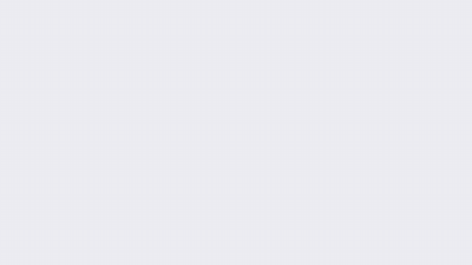
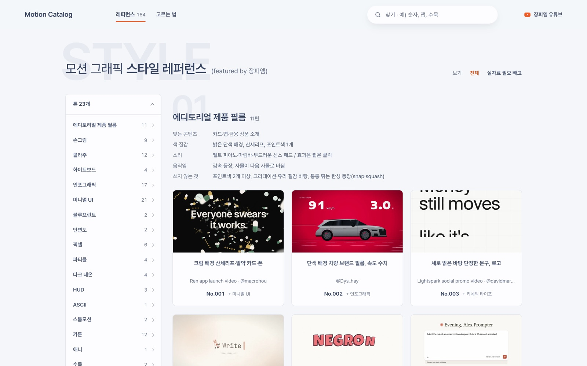

# motion-graphic-video

Claude Code 또는 Codex로 모션그래픽 소개 영상을 만드는 작업 폴더입니다.
HTML 한 파일이 시간 t 의 화면을 계산하고, Chrome 이 프레임을 찍고, ffmpeg 가 소리와 합쳐 mp4 를 만듭니다. 영상 편집 프로그램은 쓰지 않습니다.



위 홍보 영상도 이 저장소로 만들었습니다. 영상 속 클립 벽과 회전 목마의 클립은 이 저장소로 만든 실제 영상입니다.
[mp4 로 보기](docs/media/promo.mp4) · 30초 · 1920×1080 · 소리 없음

## 레퍼런스 카탈로그

### 👉 [motion-reference-catalog.vercel.app](https://motion-reference-catalog.vercel.app/)

[](https://motion-reference-catalog.vercel.app/)

설치 없이 브라우저에서 바로 볼 수 있습니다. 모션그래픽 레퍼런스 227편을 톤 24개로 묶었습니다.

- 톤마다 맞는 콘텐츠, 색·질감, 소리, 움직임, 쓰지 않는 것을 정리했습니다.
- 카드에 마우스를 올리면 레퍼런스 영상이 재생됩니다. 실자료나 AI 이미지가 필요한 항목은 카드에 표시합니다.
- 카드를 눌러 자세히 보고, 소개할 대상을 적은 뒤 "이 스타일로 만들기"를 누르면 고른 내용이 클립보드에 복사됩니다. Claude Code 또는 Codex 채팅에 붙여 넣으면 그 스타일로 영상을 만듭니다.

## 이렇게 동작합니다

```
소개할 대상(URL·문서·설명)
  → 사실 확인 (FACTS.md)
  → 레퍼런스 후보 6개 비교 화면 → 사람이 1개 고름        ← 확인 지점 1
  → 스토리보드 확인 화면 → 사람이 승인                   ← 확인 지점 2
  → 소리 (ElevenLabs · 없으면 코드 합성)
  → 화면 코드 (src/index.html 의 window.seek(t))
  → 검수 시트·결정성 검사 → 렌더 → mp4
```

- 사람이 고르는 곳은 두 곳뿐입니다. 선택과 승인 사이의 제작 작업은 에이전트가 진행합니다.
- 같은 t 에는 항상 같은 화면이 나옵니다. 그래서 프레임을 순서 없이 나눠 찍어도 결과가 같습니다.
- 레퍼런스는 공개된 모션그래픽 예시와 표현 기법 데모를 모은 색인(약 1,000건)에서 찾습니다. 영상을 보고 톤을 판정한 항목만 후보로 나옵니다. 문장과 브랜드 이름은 옮기지 않고 구조·박자·전환·타이포 처리만 참고합니다.

## 필요한 것

| 구분 | 항목 | 용도 |
|---|---|---|
| 택 1 | [Claude Code](https://claude.com/claude-code) 또는 [Codex](https://github.com/openai/codex) | 프로젝트를 열고 영상 제작 요청 |
| 필수 | Node.js 24 이상 | 렌더러, 확인 화면 |
| 필수 | Google Chrome (시스템 설치) | 프레임 촬영 |
| 필수 | ffmpeg | 영상·소리 합성 |
| 필수 | Python 3 | 소리 합성 (`scripts/mix.py`) |
| 선택 | Python 패키지 `numpy` `pillow` `scipy` | 음악·효과음 합성, 음악 박자 분석, AI 이미지 배경 지우기 |
| 권장 | ElevenLabs 커넥터 (Claude·Codex · 크리에이티브판, [연결 방법](#elevenlabs-연결-권장)) | 내레이션·음악·효과음 생성. 내레이션은 이 커넥터로만 만듭니다. **크레딧이 듭니다** |
| 선택 | [Codex CLI](https://github.com/openai/codex) + ChatGPT 로그인 | AI 일러스트 생성. **ChatGPT 요금제 한도에서 나갑니다** |
| 선택 | `whisper` 명령 (`brew install openai-whisper`) | 내레이션 단어 시각 측정 |

ElevenLabs 커넥터가 없어도 영상을 만들 수 있습니다. 배경음악과 효과음은 `scripts/synth.py` 가 코드로 합성합니다(numpy 필요, 비용 없음). 이때 내레이션은 넣지 않고 화면 문구로 전달합니다. 가진 음원 파일을 넣거나 소리 없이 만들 수도 있습니다.

macOS (Apple Silicon) 에서 확인했습니다. 스크립트에 Windows 대응 코드가 있지만 이 공개본으로는 시험하지 않았습니다.

## 설치

도구를 미리 다 설치하지 않아도 됩니다. Claude Code 나 Codex 가 첫 작업 때 위 표의 도구를 확인하고, 없는 것은 패키지 관리자(macOS `brew`, Windows `winget`)로 설치합니다. 설치 명령은 실행 승인 창에서 허락하면 됩니다. 비밀번호·관리자 권한이 필요한 설치(Homebrew 등)와 계정 로그인(Codex CLI, ElevenLabs)만 직접 하시면 됩니다. 점검 순서는 [setup.md](.claude/skills/motion-video/references/setup.md) 에 있습니다.

직접 설치하려면 아래 순서를 따릅니다.

```bash
git clone https://github.com/byungjunjang/motion-graphic-video.git
```

```bash
cd motion-graphic-video
npm ci
```

선택 기능을 쓰려면 Python 패키지를 설치합니다.

```bash
python3 -m pip install numpy pillow scipy
```

### ElevenLabs 연결 (권장)

ElevenLabs 공식 원격 MCP 의 크리에이티브판을 씁니다. API 키는 필요 없고, ElevenLabs 계정으로 로그인합니다.

#### Claude

1. claude.ai 설정의 커넥터 화면에서 커스텀 커넥터를 추가합니다.
2. 주소에 `https://api.elevenlabs.io/v1/mcp-creative` 를 넣습니다.
3. ElevenLabs 계정으로 로그인해 권한을 허용합니다.
4. 새 세션에서 `creative_` 로 시작하는 도구가 보이면 연결된 것입니다.

#### Codex

먼저 로컬 Codex CLI에서 `/mcp`로 연결된 서버를 확인하세요. 크리에이티브판이나 전체판이 이미 연결되어 있다면 아래의 도구 확인으로 넘어가세요. 연결된 서버가 없으면 터미널에서 다음 명령으로 크리에이티브판을 등록하세요.

```sh
codex mcp add elevenlabs --url https://api.elevenlabs.io/v1/mcp-creative
```

직접 설정하려면 위 명령 대신 개인 `~/.codex/config.toml`에 아래 항목을 추가하세요.

```toml
[mcp_servers.elevenlabs]
url = "https://api.elevenlabs.io/v1/mcp-creative"
```

등록할 때 로그인 창이 열리면 ElevenLabs 계정으로 로그인하고 접근을 승인하세요. 아직 로그인하지 않았다면 `codex mcp login elevenlabs`를 실행하세요. [Codex MCP 공식 안내](https://developers.openai.com/codex/mcp/)

새 Codex CLI 세션에서 `/mcp`로 ElevenLabs 도구 목록을 확인하세요. 서버 접두어 뒤에서 다음 이름을 찾으세요.

- 내레이션 · `creative_list_voices`, `creative_generate_speech`
- 음악·효과음 · `creative_create_flow`, `creative_add_flow_node`, `creative_run_flow_nodes`, `creative_get_flow_run_status`

음악 지원 여부는 `creative_get_flow_node_types`로 노드 종류를 조회해 `music`이 있는지 확인하세요. 스토리보드 승인 후 음악을 만들 때는 `creative_add_flow_node`의 `node_type`에 `music`을 씁니다.

#### 서버 버전 비교

| 버전 | 주소 | 이 프로젝트에서 |
|---|---|---|
| 크리에이티브판 | `/v1/mcp-creative` | **권장**. 음성·음악·효과음이 모두 있습니다 |
| 전체판 | `/v1/mcp` | 동작합니다. 2026-11 에 Claude에서 확인했을 때 크리에이티브판과 같은 도구 241개(음성 에이전트 관리 도구 포함)가 보였습니다 |
| 커넥터 디렉터리판 | `/v1/mcp-creative-claude-marketplace` | **쓰지 마세요**. 음악 생성이 없어 음악 단계에서 멈춥니다 |

- claude.ai 커넥터 목록에서 바로 추가하는 ElevenLabs 는 디렉터리판입니다. 커스텀 커넥터로 크리에이티브판을 추가하세요.
- 크리에이티브판과 전체판을 같이 연결하지 마세요. 같은 도구가 두 벌 생깁니다.
- API 키를 쓰는 로컬 서버(`elevenlabs-mcp`)는 도구 이름이 달라 이 프로젝트에서 동작하지 않습니다.
- 버전 설명은 [ElevenLabs 문서](https://elevenlabs.io/docs/eleven-creative/mcp)를 따릅니다.

## 첫 영상 만들기

설치 후 Codex 앱에서 복제한 `motion-graphic-video` 폴더를 로컬 프로젝트로 열거나, 같은 폴더의 터미널에서 `codex`를 실행하세요. Claude Code에서는 같은 위치에서 `claude`를 실행하세요.

> 이 프로젝트를 처음 보는 유튜브 시청자에게 소개하는 15초 모션그래픽을 만들어줘. README에서 사실을 확인하고, 무음으로 만들어줘.

스타일부터 직접 고르려면 “카탈로그를 보여줘”라고 요청하세요. 공개 카탈로그에서 이미 골랐다면 복사한 내용을 채팅에 붙여 넣으세요. 스토리보드를 승인하면 제작을 진행하고 완성한 MP4를 `videos/<id>/renders/video.mp4`에 저장합니다.

## 비용이 드는 곳

- **ElevenLabs** · 스토리보드를 승인한 뒤에만 생성합니다. 같은 생성을 재시도하지 않게 스킬에 적혀 있습니다.
- **Codex 이미지** · 일러스트가 필요한 톤에서만 씁니다. 처음에는 디자인 시트 1장과 장면 그림 3~6장만 만듭니다.
- 렌더, 소리 합성, 믹스는 로컬에서 하므로 비용이 없습니다.

## 폴더 구조

```
.claude/skills/
  motion-video/        영상 제작 단계 (0~8단계) 와 레퍼런스 문서
  motion-catalog/      카탈로그에서 스타일을 먼저 고르는 흐름
  motionmaxxing/       렌더 측정 도구를 빌려 쓰는 외부 스킬 (Apache-2.0)
  codex-image/         AI 이미지 생성 스킬 (MIT)
scripts/
  refs.mjs             레퍼런스 색인·검색·후보 비교 화면
  catalog.mjs          톤별 카탈로그 화면
  storyboard.mjs       스토리보드 확인 화면
  render.mjs           프레임 촬영, 검수 시트, 결정성 비교
  synth.py             배경음악·효과음 코드 합성 (ElevenLabs 가 없을 때)
  mix.py               소리 섞기 → mp4
  audio-probe.py       길이·무음·박자 측정
  key.py               AI 이미지의 마젠타 바탕 지우기
references/            분석 노트, 톤 판정 (색인 파일은 처음 실행할 때 만들어집니다)
templates/starter/     새 영상의 본보기
vendor/                three.js, 손그림 키트, 3D 재질 키트, 종이 질감
videos/<id>/           영상 한 편 (git 에 올라가지 않습니다)
```

자세한 규칙은 `CLAUDE.md` 와 `.claude/skills/motion-video/SKILL.md` 에 있습니다. Codex는 `AGENTS.md`에서 시작해 같은 제작 지침을 읽습니다.

Codex용 진입 파일은 `.agents/skills/`에 있습니다. 원본 설명을 수정하면 `python scripts/sync_codex_skills.py`로 갱신하고 `python scripts/sync_codex_skills.py --check`로 확인하세요.

## 지켜야 할 것

- 실존 브랜드의 로고·제품 이미지는 권리자가 허락한 파일만 씁니다.
- 레퍼런스 영상의 문장과 브랜드 이름을 옮기지 않습니다.
- 화면에 쓰는 숫자·조건·이름은 원문에서 확인한 것만 씁니다.
- ElevenLabs 로 만든 음원의 사용 조건은 가입한 요금제를 따릅니다.

## 라이선스

이 저장소에서 직접 쓴 코드와 문서는 [MIT](LICENSE) 입니다.
함께 들어 있는 외부 구성 요소와 레퍼런스 출처는 [THIRD_PARTY_NOTICES.md](THIRD_PARTY_NOTICES.md) 를 보세요.
